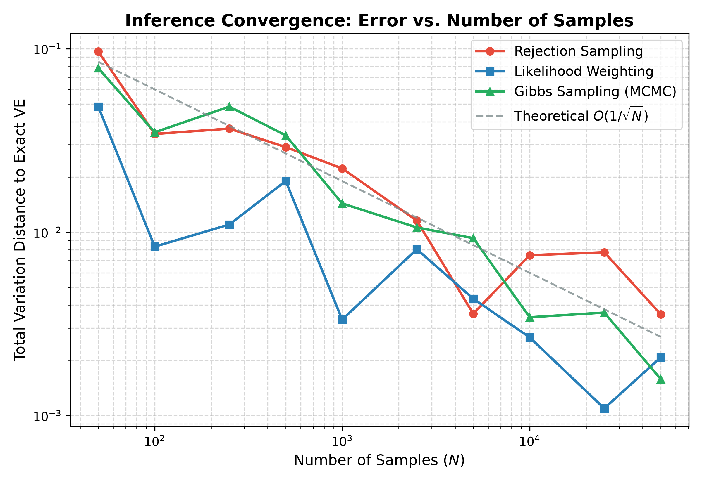
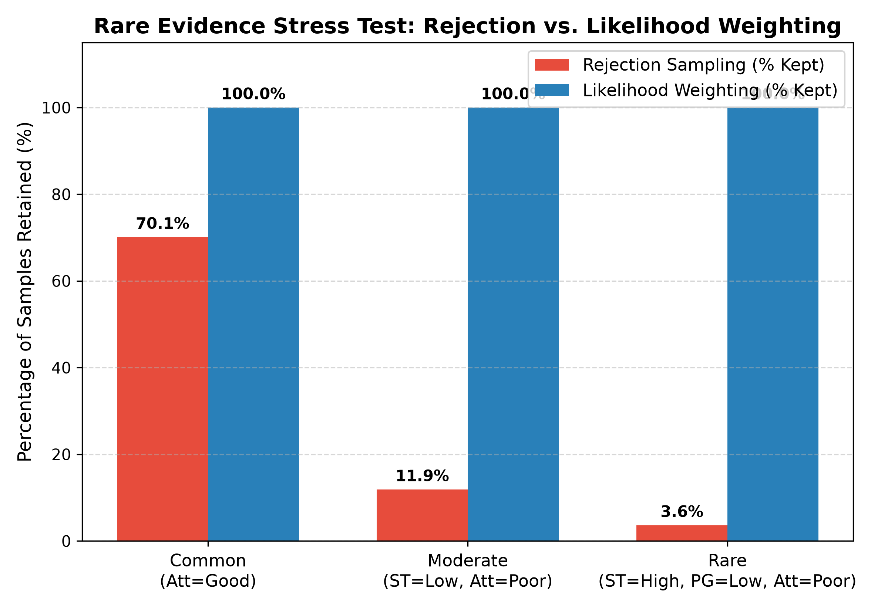
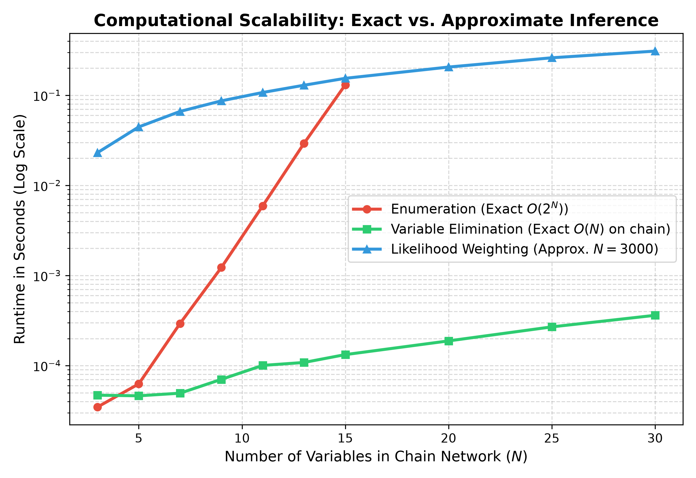

# Student Performance Prediction with Bayesian Inference

An educational project designed to explain and compare **Exact vs. Approximate Inference** in Bayesian Networks from scratch.

---

## Core Question & Presentation Storyline

> **"Exact inference is correct but gets expensive. Approximate inference is cheap but noisy. When do you use which?"**

1. **Problem**: Given evidence (e.g. `StudyTime = High`, `Attendance = Poor`), what is $P(\text{FinalGrade} \mid \text{evidence})$?
2. **Brute Force (Enumeration)**: Exact, but sums over the full joint distribution, growing exponentially ($O(2^N)$).
3. **Variable Elimination (VE)**: Pushes summations inside factor products using the min-fill heuristic to avoid materializing large tables.
4. **Why Exact Breaks**: Large intermediate factors in dense networks (high treewidth) make exact inference intractable, motivating approximation.
5. **Approximate Methods**:
   - **Rejection Sampling**: Simulates worlds from the prior and rejects inconsistent ones (simple, but collapses on rare evidence).
   - **Likelihood Weighting**: Fixes evidence variables and accumulates sample likelihood weights (resilient to rare evidence).
   - **Gibbs Sampling (MCMC)**: Resamples one non-evidence variable at a time from its Markov blanket conditional distribution.
6. **Empirical Benchmarks**: Convergence rates, rare evidence resilience, and exponential vs. linear runtime scaling.

---

## Project Structure

```text
03-student-performance-bayes/
├── factor.py
├── network.py
├── exact.py
├── sampling.py
├── synthetic.py
├── plots.py
├── download_data.py
├── compare.py
├── figures/
│   ├── 01_convergence_error.png
│   ├── 02_rare_evidence.png
│   └── 03_runtime_scaling.png
├── data/
│   └── raw/
│       ├── student-mat.csv
│       └── student-por.csv
├── notebooks/
│   └── 01_bayes_theorem.ipynb
├── pyproject.toml
├── requirements.txt
└── README.md
```

### Module Responsibilities

| File | Responsibility |
|---|---|
| `factor.py` | Multi-dimensional discrete Factor algebra (product, marginalize, reduce, normalize) |
| `network.py` | `BayesNet` class managing DAG topology, CPTs, topological sort, and Markov blankets |
| `exact.py` | Exact inference via Enumeration and Variable Elimination (min-fill ordering heuristic) |
| `sampling.py` | Approximate inference: Rejection Sampling, Likelihood Weighting, and Gibbs Sampling (MCMC) |
| `synthetic.py` | 4-node student network, 5-node test network, and variable-length Markov chain generator |
| `plots.py` | Plotting helpers for posterior bar charts and convergence curves |
| `compare.py` | Benchmark script producing the 3 presentation figures into `figures/` |
| `download_data.py` | Automated downloader for UCI Student Performance datasets |

---

## Quickstart

### 1. Environment Setup

Using `venv` and `pip`:

```bash
cd 03-student-performance-bayes
python3 -m venv .venv
source .venv/bin/activate
pip install -r requirements.txt
pip install -e .
```

Or using `uv`:

```bash
cd 03-student-performance-bayes
uv venv
source .venv/bin/activate
uv pip install -r requirements.txt
uv pip install -e .
```

### 2. Run Comparative Benchmarking

Generate all 3 presentation plots into `figures/`:

```bash
python compare.py
```

### 3. Download the UCI Dataset

Fetch and extract the student performance datasets (`student-mat.csv` and `student-por.csv`):

```bash
python download_data.py
```

### 4. Run Notebooks

Launch Jupyter Lab to explore interactive pedagogical notebooks:

```bash
jupyter lab notebooks/
```

---

## Live Demo: Answering the Same Query with All 5 Methods

```python
from exact import enumeration_ask, variable_elimination
from sampling import (
    gibbs_sampling,
    likelihood_weighting,
    rejection_sampling,
)
from synthetic import student_network

bn = student_network()
query = "FinalGrade"
evidence = {"StudyTime": "Low", "Attendance": "Good"}

exact_enum = enumeration_ask(bn, query, evidence)
exact_ve = variable_elimination(bn, query, evidence)
rej = rejection_sampling(bn, query, evidence, n_samples=30000, seed=42)
lw = likelihood_weighting(bn, query, evidence, n_samples=30000, seed=42)
gibbs = gibbs_sampling(bn, query, evidence, n_samples=30000, burn_in=1000, seed=42)

print("Exact (Enumeration):", exact_enum)
print("Exact (VE):         ", exact_ve)
print("Rejection Sampling: ", rej)
print("Likelihood Weight:  ", lw)
print("Gibbs Sampling:     ", gibbs)
```

---

## The Three Presentation Benchmarks

### 1. Convergence Error vs. Number of Samples
Shows error shrinking at rate $O(1/\sqrt{N})$ as sample count increases:


### 2. Rare Evidence Experiment
Demonstrates why Likelihood Weighting is essential when conditioning on unlikely scenarios where Rejection Sampling collapses:


### 3. Scalability: Runtime vs. Number of Variables
Demonstrates Enumeration exploding exponentially ($O(2^N)$) on long chains, while Variable Elimination and Likelihood Weighting scale linearly:

